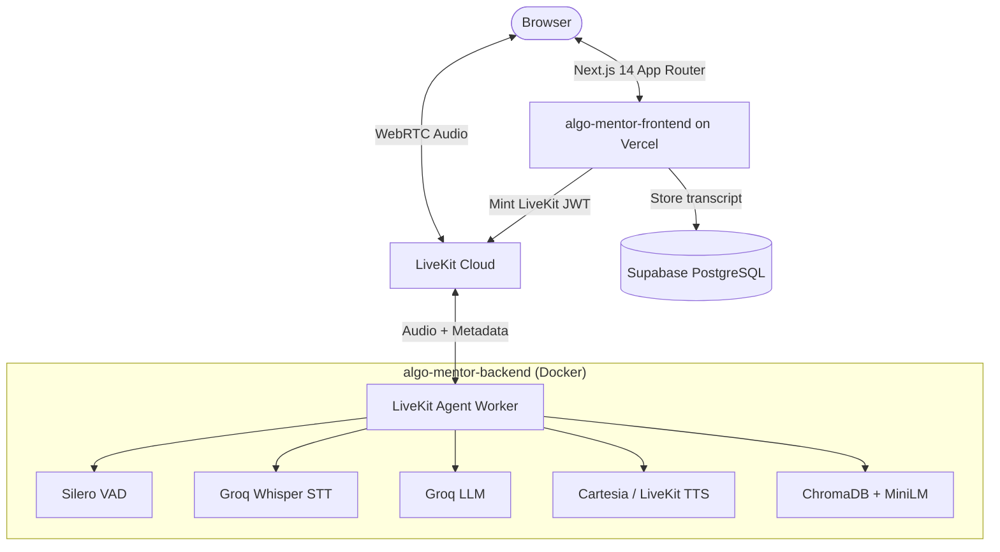

<div align="center">

# AlgoMentor

**A real-time voice tutor that teaches Data Structures & Algorithms through Socratic scaffolding — hints, not answers.**

A Next.js app on Vercel mints LiveKit tokens and joins a WebRTC room with a Python LiveKit agent that listens, thinks, and speaks back in real time. The tutor is grounded in curated notes for seven DSA topics, chunked by section and embedded with MiniLM in ChromaDB.

[](https://nextjs.org/)
[](https://www.python.org/)
[](https://livekit.io/)
[](https://groq.com/)
[](https://www.trychroma.com/)
[](https://supabase.com/)
[](LICENSE)

</div>

---

## Table of Contents

- [How It Works](#how-it-works)
- [Architecture](#architecture)
- [Voice Pipeline](#voice-pipeline)
- [RAG Grounding](#rag-grounding)
- [Session Persistence](#session-persistence)
- [Evaluation](#evaluation)
- [Repository Structure](#repository-structure)
- [Setup](#setup)
  - [Prerequisites](#prerequisites)
  - [Database (Supabase)](#database-supabase)
  - [Backend (Python Agent)](#backend-python-agent)
  - [Frontend (Next.js)](#frontend-nextjs)
- [Deployment](#deployment)
  - [Backend — Docker on Oracle Cloud](#backend--docker-on-oracle-cloud)
  - [Frontend — Vercel](#frontend--vercel)
- [Adding New Topics](#adding-new-topics)
- [License](#license)

---

## How It Works

Preparing for technical interviews by typing code in silence doesn't match the real experience, where engineers talk through their thought process, explore edge cases, and justify complexity out loud.

AlgoMentor closes that gap. You speak into your microphone, and the tutor responds verbally with Socratic questions — intuition prompts, small numerical examples, and targeted hints — rather than dumping solutions or code. Session transcripts are stored in Supabase (PostgreSQL) for authenticated students so they can resume where they left off.

---

## Architecture



| Layer | Stack | What it does |
|---|---|---|
| **Frontend** | Next.js 14, React 18, Tailwind CSS, `@livekit/components-react` | Renders the dashboard, mints room tokens via `/api/course`, streams audio and live captions, persists transcripts to Supabase via `/api/store-conversation`. |
| **Agent** | Python 3.12, `livekit-agents` 1.5, ChromaDB, `sentence-transformers` | Joins the LiveKit room, retrieves the topic notes from the vector store at session start, runs the voice pipeline (below), generates Socratic responses, and streams speech back. Deployed in Docker. |
| **Transport** | LiveKit Cloud | Low-latency WebRTC mesh routing audio between the browser and the agent worker. |
| **Inference** | Groq (Whisper STT + hosted LLM), Cartesia / LiveKit TTS | Hardware-accelerated speech-to-text, fast token generation, and natural speech synthesis. |
| **Vector DB** | ChromaDB (local persistent storage) | Stores chunked embeddings of seven DSA topic guides with cosine similarity search. |
| **Database** | Supabase (PostgreSQL) | Stores session transcripts, message roles, topic IDs, student metadata, and timestamps. |

---

## Voice Pipeline

The agent's voice pipeline chains five stages with tuned turn-taking parameters (defaults shown; each can be overridden with an environment variable):

```
Microphone → Silero VAD → Groq Whisper STT → Groq LLM (system prompt with retrieved notes) → Cartesia TTS → Speaker
```

- **Silero VAD** detects speech activity with configurable silence thresholds (`min_silence_duration: 0.65s`, `min_speech_duration: 0.05s`).
- **Groq Whisper** (`whisper-large-v3-turbo`) transcribes the spoken input.
- **Groq LLM** (`openai/gpt-oss-20b`, temperature 0.6, up to 120 tokens per reply) generates the tutor's response.
- **End-of-turn delays** (`min: 0.5s`, `max: 1.2s`) prevent the tutor from interrupting the student mid-thought.
- **Preemptive generation** starts generating a reply as soon as the final transcript arrives, before the end of the student's turn is confirmed, and discards it if the student keeps talking. This keeps latency low.
- **Cartesia TTS** (`cartesia/sonic-2` through LiveKit Inference by default; direct Cartesia or Groq TTS can be selected with `TTS_PROVIDER`) synthesizes the tutor's spoken response.

---

## RAG Grounding

The tutor is grounded in curated notes for seven DSA topics, stored in [`algo-mentor-backend/course_material/`](algo-mentor-backend/course_material/). Each markdown guide is chunked by section and embedded with `sentence-transformers/all-MiniLM-L6-v2` into a local ChromaDB collection. When a session starts, the agent pulls the topic's overview sections and the three highest-ranked chunks (by cosine similarity) and adds them to the LLM system prompt.

| Topic | Key Concepts | Example Problems |
|---|---|---|
| **Binary Search** | Monotonic search spaces, overflow-safe midpoint (`left + (right - left) // 2`), boundary conditions | Search in Rotated Sorted Array, First/Last Position |
| **Linked Lists** | Fast/slow pointers, Floyd's cycle detection, in-place reversal, dummy heads | Reverse Linked List, Merge Two Sorted Lists |
| **Trees & BST** | Recursive traversals, BFS level-order, BST validation with global min/max bounds | Maximum Depth, Validate BST |
| **Heaps & Priority Queues** | Floyd's bottom-up $O(N)$ build-heap vs. repeated-insertion $O(N \log N)$, sift-down | Kth Largest Element, Merge K Sorted Lists |
| **Two Pointers** | Opposite-end sweep, same-direction sliding window, duplicate filtering | Two Sum II (Sorted), 3Sum, Container With Most Water |
| **Graphs** | BFS shortest path, DFS cycle detection, Kahn's topological sort | Number of Islands, Course Schedule |
| **Dynamic Programming** | Overlapping subproblems, state transitions, top-down vs. bottom-up | Coin Change, Longest Increasing Subsequence |

Each guide includes an overview, intuition, Python code templates, edge cases & pitfalls, complexity analysis, and top interview questions.

---

## Session Persistence

- **Guest mode**: One-click practice without login; sessions are ephemeral.
- **Authenticated mode**: Email + username sign-up via Supabase Auth. Session transcripts and summaries are persisted to the `conversations` table on disconnect (`POST /api/store-conversation`), enabling session history review and resumption.

---

## Evaluation

An evaluation harness in [`algo-mentor-backend/eval/`](algo-mentor-backend/eval/) benchmarks the tutor with simulated students and an LLM judge. The answer-revealing and guidance checks are adapted from MRBench (Maurya et al., NAACL 2025), which labels each tutor response on its own three-level scales, and from Google's LearnLM evaluation work; the 1–5 guidance score and the other metrics are this project's own. Full methodology: [`EVALUATION_GUIDE.md`](algo-mentor-backend/eval/EVALUATION_GUIDE.md).

### Method

1. **Fact-check benchmark** — 105 ground-truth questions (15 per topic), written from the course notes and CLRS, with known answer keys and pitfall misconceptions. The tutor answers from its base system prompt, without the retrieved notes (see [Limitations](#limitations)), and an LLM judge scores each answer against the key.
2. **Simulated student dialogues** — 40 multi-turn scenarios across four personas (cooperative beginner, misconception-prone, impatient demander, doubtful verifier). Each transcript is scored for answer leakage, Socratic guidance quality (1–5, this project's own scale), factual correctness, and pedagogical scaffolding adherence.
3. **Train/test split** — Prompts were tuned on a 30% development split; the numbers below are from the frozen 70% test split.

### Results

| Metric | Score | Target |
|---|---|---|
| **Factual accuracy** (questions from the course notes) | **98.6%** | ≥ 95% |
| **No answer revealed** (adapted from MRBench's "revealing of the answer") | **100%** in 28 dialogues | ≥ 95% |
| **Socratic guidance** (cooperative beginner) | **4.25 / 5** | ≥ 4.5 |
| **Socratic guidance** (doubtful verifier) | **2.86 / 5** | ≥ 4.5 |
| **Pitfall avoidance** | **100%** | ≥ 95% |
| **Pedagogical scaffolding adherence** | **64.3%** | ≥ 90% |

> Guidance fell from 4.25/5 with cooperative students to 2.86/5 with doubtful verifiers, simulated students who propose a flawed or naive approach and ask the tutor to confirm it. The tutor sometimes validated these approaches too gently instead of steering toward a better solution. No answers were revealed in any of the 28 evaluated dialogues.

#### Per-Topic Factual Accuracy

| Topic | Accuracy | Questions |
|---|---|---|
| Heaps | 100.0% | 9 |
| Binary Search | 100.0% | 12 |
| Two Pointers | 100.0% | 9 |
| Linked Lists | 100.0% | 12 |
| Trees | 88.9% | 9 |
| Graphs | 100.0% | 12 |
| Dynamic Programming | 100.0% | 9 |

### Limitations

- The benchmark runs the tutor on its base system prompt. The retrieved course notes that live sessions use are not yet injected, so these results measure the tutor without retrieval.
- All scores come from a single LLM judge and have not been checked by hand.
- If a judge call fails, the harness currently records a default passing score; such cases are not yet excluded from the results.
- The test split is small (28 dialogues, 7 of them doubtful verifiers), so per-persona scores are noisy.

### Running the Evaluation

```bash
cd algo-mentor-backend

# Full evaluation (105 fact-checks + 40 simulated dialogues):
python eval/run_eval.py --mode all

# Fact-check only:
python eval/run_eval.py --mode fact-check

# Quick sample (5 items):
python eval/run_eval.py --mode all --sample 5

# Frozen 70% test split:
python eval/run_eval.py --mode all --split test-70

# Evaluate real sessions stored in Supabase:
python eval/evaluate_supabase.py
```

Reports are written to [`eval/reports/`](algo-mentor-backend/eval/reports/):
- [`eval_report.json`](algo-mentor-backend/eval/reports/eval_report.json) — machine-readable
- [`eval_report.md`](algo-mentor-backend/eval/reports/eval_report.md) — human-readable

---

## Repository Structure

```text
AlgoMentor/
├── algo-mentor-backend/                # Python LiveKit agent & RAG engine
│   ├── main.py                         # Agent worker + aiohttp keep-alive server (:7860)
│   ├── prompts.py                      # Socratic system prompts & RAG injection
│   ├── rag_manager.py                  # ChromaDB chunking, embedding & retrieval
│   ├── build_index.py                  # CLI to index course_material/ into ChromaDB
│   ├── course_material/                # Curated markdown guides (7 topics)
│   ├── rag_storage/                    # ChromaDB vector store (auto-created)
│   ├── eval/                           # Evaluation harness
│   │   ├── EVALUATION_GUIDE.md         # Methodology & academic grounding
│   │   ├── run_eval.py                 # Main harness (fact-check + simulation)
│   │   ├── judge.py                    # LLM-as-a-judge (checks adapted from MRBench/LearnLM)
│   │   ├── simulator.py               # Multi-turn student persona simulator
│   │   ├── evaluate_supabase.py        # Evaluate real Supabase sessions
│   │   ├── report_generator.py         # JSON & Markdown report output
│   │   ├── data/                       # Ground-truth datasets
│   │   └── reports/                    # Generated reports
│   ├── Dockerfile
│   ├── docker-compose.yml
│   └── requirements.txt
│
├── algo-mentor-frontend/               # Next.js 14 web application
│   ├── src/
│   │   ├── app/                        # App Router pages & API routes
│   │   │   ├── page.tsx                # Landing page
│   │   │   ├── course/page.tsx         # Topic selection
│   │   │   ├── course/[courseId]/page.tsx  # Active voice session
│   │   │   ├── history/page.tsx        # Session history
│   │   │   └── api/                    # Token minting, session storage, history
│   │   ├── components/                 # UI components
│   │   └── lib/                        # Auth context, Supabase client, hooks
│   ├── package.json
│   └── tailwind.config.ts
│
└── supabase/
    └── schema.sql                      # Table definitions & RLS policies
```

---

## Setup

### Prerequisites

- **Node.js** 18+ &nbsp;·&nbsp; **Python** 3.10–3.12
- [LiveKit Cloud](https://cloud.livekit.io) project (free tier)
- [Groq](https://console.groq.com) API key
- [Supabase](https://supabase.com) project (free tier)

### Database (Supabase)

Run [`supabase/schema.sql`](supabase/schema.sql) in the Supabase SQL Editor:

```sql
create table if not exists conversations (
  id uuid primary key default gen_random_uuid(),
  user_id uuid references auth.users(id) on delete cascade,
  user_email text,
  user_name text,
  topic_id text not null,
  session_day int default 1,
  messages jsonb not null,
  summary text,
  created_at timestamptz default now()
);

create index if not exists idx_conversations_user_topic
  on conversations (user_id, topic_id, created_at desc);

alter table conversations enable row level security;
```

### Backend (Python Agent)

```bash
cd algo-mentor-backend
python -m venv .venv
source .venv/bin/activate        # Windows: .\.venv\Scripts\Activate.ps1
pip install -r requirements.txt
cp .env.example .env             # fill in LiveKit + Groq credentials
python build_index.py            # index course_material/ into ChromaDB
python main.py dev               # start agent worker + health server on :7860
```

### Frontend (Next.js)

```bash
cd algo-mentor-frontend
npm install
cp .env.example .env.local       # fill in LiveKit + Supabase credentials
npm run dev                      # http://localhost:3000
```

---

## Deployment

### Backend — Docker on Oracle Cloud

The backend is deployed as a Docker container on an OCI `VM.Standard.A1.Flex` instance (2 OCPUs, 12 GB RAM):

```bash
cd algo-mentor-backend
docker compose up -d --build     # builds image, starts container on :7860
curl http://localhost:7860/health # verify
```

The `docker-compose.yml` includes health checks and persistent volume mounting for ChromaDB. Port 7860 must be open in both the OCI VCN security list and the instance firewall.

### Frontend — Vercel

1. Import the repository on [Vercel](https://vercel.com).
2. Set **Root Directory** to `algo-mentor-frontend`.
3. Add environment variables: `LIVEKIT_URL`, `LIVEKIT_API_KEY`, `LIVEKIT_API_SECRET`, `NEXT_PUBLIC_SUPABASE_URL`, `NEXT_PUBLIC_SUPABASE_PUBLISHABLE_KEY`.
4. Deploy.

---

## Adding New Topics

1. Add `<topic-id>.md` to `algo-mentor-backend/course_material/` following the existing format (frontmatter + sections for overview, intuition, code template, edge cases, complexity).
2. Run `python build_index.py` to re-embed into ChromaDB.
3. Register the topic key in [`prompts.py`](algo-mentor-backend/prompts.py) and [`topics.ts`](algo-mentor-frontend/src/lib/topics.ts).

---

## License

Distributed under the [MIT License](LICENSE).
